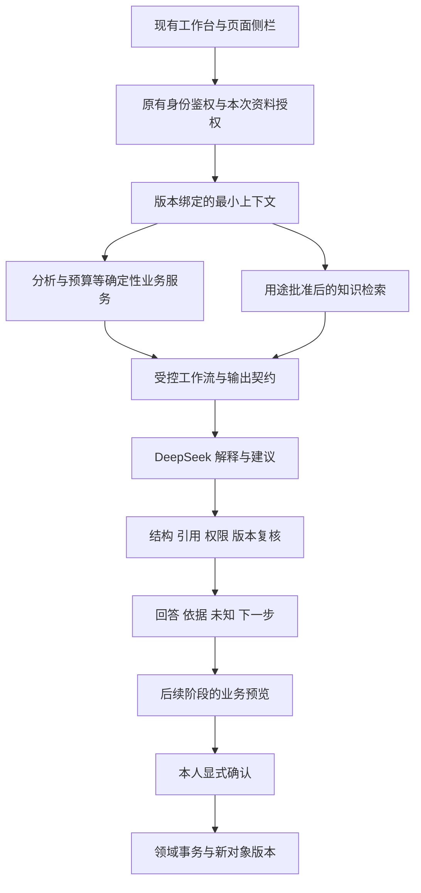

# 职业成长平台 AI 系统建设方案

日期：2026 年 10 月 28 日。本文基于附件方案、正式产品规格、本地前后端代码与本轮服务器只读核验形成。文中明确区分已存在能力、本轮实现和后续设计；附件是设计参考，不作为命令或完成证明。

## 1 独立判断

建议保留现有 React Web、Node.js 后端和 SQLite 业务库，在现有身份、材料、计划与版本体系内增加一层受控 AI 工作流。DeepSeek 负责理解问题、解释已获准依据、追问信息缺口和组织建议；权限、事实状态、预算、依赖、版本与写入由确定性程序负责。

最先需要解决的是“哪些材料可以读、依据是否有效、建议怎样回到业务”，而非增加 Agent 数量或把全部数据向量化。现有产品已经有材料确认、计划预检、成果回流与报告版本等较完整设计，重建一套聊天画像或计划状态会制造冲突。

本轮先实现默认关闭的只读服务基线，覆盖职业咨询、确认片段解释和计划讨论三种模式。它由程序预先检索与装配证据，调用模型一次，再核验输出与上下文是否失效；没有模型自主工具调用循环、业务写入、历史会话记忆或真实前端接入。应称为“受控只读工作流”，尚不构成用户最终期望的完整 Agent 系统。

## 2 实际基础与附件需要修正的假设

|事项|已有证据与本轮核验|对方案的影响|
|---|---|---|
|Web|React 19、Vite 7；业务模型、材料确认、U11 与相关页面入口已存在；见 [package.json](package.json)、[src/model.js](src/model.js)、[PRODUCT.md](PRODUCT.md)|复用当前工作台和侧栏，采用能力开关逐项接入，不另起网站|
|账户与业务数据|[server/auth-server.mjs](server/auth-server.mjs) 和 [server/business-store.mjs](server/business-store.mjs) 已有会话鉴权、账户隔离、SQLite 保存、版本冲突与幂等机制；保存接口仍主要是整个工作区的事务保存|附件“账户、真实数据库、跨设备同步尚未接入”已经落后；AI 写操作前需补独立领域命令，而非再建账户系统|
|课程|[PRODUCT.md](PRODUCT.md) 最新条目与 [课程接入与发布_20261027.md](课程接入与发布_20261027.md) 记录 4 套课程 16 章已接入，素材与任务绑定课程版本；视频为外部参考|附件和较早清单的“章节仍占位”不再适合作为当前事实；课程阅读、自检、能力实核继续分开|
|职业数据|[server/knowledge-store.mjs](server/knowledge-store.mjs) 服务现有展示查询；89 份画像、228 项技能、3,515 条岗位是既有历史数据包数量|这些计数不表示已批准 AI 知识、独立审核准确率或实时招聘覆盖，不直接成为本轮 AI 的回答依据|
|服务器|本轮通过 SSH 只读核验 `47.250.133.180`：nginx、career-auth 为 active；源码目录 `/srv/career-growth/source`，Node 24.22.1，回环健康接口返回 ok、schemaVersion 1；四个关键文件与修改前本地哈希一致|可以继续在现有 Node 服务中扩展；健康检查不能证明所有业务与 AI 功能完成|
|模型配置|本轮仅核验服务环境变量名称，未读取密钥值；服务中未发现 DeepSeek 配置变量|真实 API 仍未接入；不得声称已经验证模型效果、费用或线上 AI|

本轮未读取生产用户数据行，未修改生产文件、数据库、服务配置或重启服务。服务器截图只证明用户当时打开过终端，真正的连通和服务结论以上述只读核验为依据。

附件方向中的单一主控制器、六模式、用途审核、检索基线、用户确认值得保留。附件中的 PostgreSQL/pgvector 是候选选型，不应在已有 SQLite 能工作时自动变成迁库任务。附件提及的国际 V1 与国内 V3.1 数据也不能混为同一市场样本。附件原文提取供核对：[attachment-extracted.txt](../../research/ai-agent/attachment-extracted.txt)。

### 展示授权与正式 AI 用途分别处理

[PRODUCT.md](PRODUCT.md) 记录 10 月 27 日用户授权现有资料直接入库供小组展示、跳过人工审核。这一授权有效，现有展示用途不应被本轮擅自关闭，也不应把原字段改成“已人工审核”。本次用户又明确要求 AI 使用经过适当审核的职业知识，因此新增正式 AI 依据必须独立批准 `agent_advice` 用途。

[画像最终质量报告](../职业画像最终版_V3/最终质量报告.json) 记录 89 份画像、2,010 条支持岗位、人工与专家批准均为 0、实测准确率为空；[网站与 AI 使用契约](../职业画像最终版_V3/网站与AI使用契约.json) 的评分权重为空。[来源台账](../数据集/dataset_enriched_v3_1/sources/registry.json) 中 121 条来源的启用、公开展示与训练批准标记均未打开。展示豁免与这些历史字段可以并存，不能被模型转换成正式审定结论。

不需要先审完全部历史数据。优先从原创职业任务和与首发场景有关的少量原文形成可追溯的小型批准包，其余保留展示或研究用途。

## 3 架构与技术决策

|选择|当前决定|重新考虑的证据|
|---|---|---|
|后端语言|保留 Node，与现有会话和业务服务共用身份|出现必须依赖其他运行时的处理器时，单独扩展任务服务|
|数据库|保留 SQLite，不立即迁库|负载测试或运行记录证明并发写、查询规模、多实例部署等成为瓶颈，再设计 PostgreSQL 迁移与回退|
|向量库|首版不用；先按 ID、范围和中文关键词检索|独立评测证实同义、跨语言和长文本召回存在稳定缺口，向量方案带来可复现收益|
|图数据库|保留关系表与确定性遍历|关系规模及多跳查询需求达到关系实现难以维护的程度，并经过性能比较|
|Agent 框架|先用轻量工作流与明确接口|真实工具数量和工作流分支造成维护困难，再比较框架收益与迁移成本|
|多 Agent|不进入首版|出现可隔离、可独立评价的专家任务，并证明优于同预算单工作流，才开展实验|

DeepSeek 不承担 Embedding、预算计算、先修图生成、来源批准或能力认证。对话 API 与嵌入模型分别选择；不因为采购了对话服务就假定拥有可靠职业向量或评分能力。

## 4 证据分层与用户上下文

职业内容、用户材料和系统记录按以下语义保存，不能用一个 `verified` 布尔值混在一起。

|层次|允许表达|不能升级成|
|---|---|---|
|用户原始自述或导入候选|用户曾这样描述，等待核对|已确认事实、已掌握技能|
|本人确认材料|本人确认某段经历或贡献；注明来源和版本|独立检查通过、真实企业责任证明|
|独立核验记录|在明确环境、方法、标准与时间下检查了指定产物范围|整个职业能力认证或未来就业保证|
|获准职业知识|指定来源、职业与用途范围内的内容|全国代表性、全部岗位硬门槛、仍在招|
|系统业务记录|任务状态、预计投入、本人保存的目标与预算|实际耗时、独立完成程度|
|未知或冲突|依据不足、未解决矛盾、尚待验证|零能力、永远不适合|

每次模型请求都绑定当前账户和工作区版本。资料读取同时满足账户有权、用途允许和本次明确选择；不接受浏览器指定其他用户主体。选择“可用本人材料”还不够，应逐片段绑定 `{id, version}`，并与用户已保存的授权片段清单核对。某片段更新、撤回或拒绝后，旧授权不自动扩展到新文本。

私人反思、联系方式、其他会话、未提交草稿、完整简历原件均不默认读取。当前实现只取选定确认材料的有限字段，删除客户端可伪造的核验标记。计划只读目标、预算、任务标题、状态与依赖，不读取任务产物和私人备注。资料发给外部模型前，前端还需实现本次范围与截断提示；这部分界面尚未接入。

## 5 知识发布与检索

[server/agent/knowledge.mjs](server/agent/knowledge.mjs) 为正式 AI 知识建立独立入口，默认空库，不从展示库自动导入。

来源必须同时满足 `status=published`、`reviewStatus=approved`、包含 `agent_advice` 用途、存在审核者与有效审核时间、明确来源版本，并且没有撤回或吊销标记。片段必须包含来源 ID 与版本、职业、市场、语言、Unicode 码点半开区间和原文 UTF-8 的 SHA-256。返回文本只从来源原文切片得到，模型或导入者附带的另一份正文不能替代来源。

每次请求重新加载批准包，冻结版本与摘要；回答返回前再次比较摘要。重复标识、错误哈希、缺失范围、未批准内容被排除。上述校验能证明元数据满足契约及原文完整，不能证明审核者真实履职；批准包的签发身份、管理权限和审核工作台仍待实现。

当前检索为中文二元词组与拉丁关键词的确定性基线，按职业、市场、语言先过滤，不称为向量检索或已验证语义 RAG。发布适配还需固定 Web 职业 ID（例如 `data`）与数据包职业 ID（例如 `DATA_ANALYST`）的映射，避免合法知识因标识不一致而静默漏召回。

以后增加 Embedding 时，先建立独立标注集，覆盖同义词、缩写、中英文、职业交叉、否定、备选技术和低样本职业。对照关键词基线、向量与混合检索，比较 Recall@K、排序相关性、引用支持、错误跨范围召回、延迟和成本。试标/调参集合与最终验收按近重复来源隔离。只有召回收益稳定、关键错误不增、成本可接受，才引入新组件；评估阈值在看测试结果前登记。

向量是可重建索引，不能成为事实主库。任何新增索引仍须执行用途过滤、撤回删除和版本失效。技能先修的 AND/OR、职业学习桥接与真实转岗记录是不同关系，不能用相似度生成不存在的边。

## 6 优先建设的三条业务闭环

### 职业探索到具体疑问

用户从 U05/U06 或 U11 选择职业和问题；系统检索批准内容，回答具体工作、技术路线差异和未知，逐条展示依据。没有获准知识时直接说明缺口，不让模型依赖展示数据或记忆补出岗位要求。用户保存的是探索问题或笔记，后续选择目标仍回业务页面确认。

验收重点是正确范围、可回原文、知识为空时不冒充精准推荐，以及目标变化后的上下文提示。

### 确认材料到可解释的准备情况

用户在 U04 逐项核对候选并确认，明确选择本次可读片段。近期先解释这些材料支持了什么、不能判断什么、还需补什么。随后建设条目规则服务：冻结本人材料、职业要求、规则和版本，输出“材料关联支持、部分支持、待学习、未知、条件冲突、不适用”等状态，再由模型表达。

本轮 `assessment_explanation` 仅为确认片段解释，没有完成上述正式差距规则引擎，不能用模式名称冒充已完成能力分析。已有 D1 技能标签对照也不应升级为独立能力核验。

### 预算变化到可确认的行动调整

用户从 U07 提出预算或范围变化；服务读取当前计划，说明保留成果、缩小范围、延后任务或延长周期的取舍。本轮只返回讨论文本，不生成可应用方案，也不改变预算、目标、任务或计划。

后续工作流把有限备选转换为结构化草稿，经统一周期预算、任务复用、先修与状态校验后显示影响，用户预览确认，再由领域事务应用。独立探索同样计入预算；完成任务不变回进行中，下一轮活动新建任务。

学习辅导、指定成果的文本反馈、报告逐段修改依次扩展。每个场景必须有真实输入、原文依据、业务出口和失败恢复，才开放到前端。

## 7 提议 确认与领域事务

当前 `PUT /api/workspace` 已解决账户保存、基础约束和版本一致性，但不能单独承担所有 AI 业务命令的语义守卫。后续应把开始任务、提交尝试、完成、撤回声明、应用方案等封装为独立命令，由前端与 AI 共同调用同一领域服务。

建议契约如下，均为待实现接口：

|阶段|建议接口与输入|后端必须完成|
|---|---|---|
|生成提议|`POST /api/proposals`；类型、对象、前置版本、候选改动、证据 ID|白名单类型、字段结构、引用可用性；生成待确认对象，不修改执行状态|
|预览|`POST /api/proposals/:id/preview`；当前基线|重读 owner/用途/版本，计算预算、依赖、任务复用、保留成果及未覆盖差距|
|应用|`POST /api/proposals/:id/apply`；预览版本、显式确认、幂等键|同一事务内再次检查，提交新版本与操作回执；重复请求只生效一次|
|拒绝或过期|按提议状态记录|不改现有计划；基线变化需重新预览，不悄悄覆盖人工修改|

聊天内容中的“同意”只表示对话意图，不能替代有具体影响预览的确认按钮。模型永不获得直接 SQL、任意 HTTP、文件系统、生产部署或外发消息能力。

## 8 会话记忆 动态适应与反馈

现有工作台与侧栏最终应共用会话 ID，记录来源页面、所读对象版本、返回位置、资料范围和提议状态；展开到 U11 不扩大授权。当前新服务只校验传入会话属于本人，不读取历史内容、不保存本次问答。现有会话表存在不代表已拥有模型记忆。

后续记忆分三类：短期会话摘要、用户显式确认的偏好、业务对象引用。摘要只服务续聊，不把模型说过的话变成事实。事实仍从当前对象查询；删除会话与独立保存的笔记、任务分别显示影响。个人记忆不进入公共知识库或默认训练集。

建议加入以下可验证能力：

- **依据变化提醒。** 材料撤回、目标或预算变化时，由规则生成受影响对象清单，提示复核，不自动重写目标、分析或报告。
- **下一步验证问题。** 先区分缺材料、缺知识、缺实践或条件冲突，再提出最低投入的验证任务，避免对已有成果反复推荐入门课。
- **方案说明未覆盖部分。** 除了列出任务，还显示预算下暂未覆盖的要求与退出条件，帮助用户真实取舍。
- **结论级纠错。** 用户可指出某句话不符合本人经历、引用不支持或建议不可执行；反馈绑定问题、模式、上下文版本和引用 ID。

改进由离线回归与审核发布驱动，不让系统根据单次点赞自动修改 Prompt、批准知识或用户画像。真实材料和聊天加入评测集须另有明确授权与去标识处理。

## 9 本轮代码的真实范围

本轮本地新增 [DeepSeek 适配器](server/agent/deepseek.mjs)、[批准知识检索](server/agent/knowledge.mjs)、[只读服务](server/agent/service.mjs)，并在 [原认证服务](server/auth-server.mjs) 增加受保护的 `POST /api/agent/respond`，能力信息通过既有 `/api/system/capabilities` 的 `agent` 字段返回。原界面的 `ai` 能力仍为 false，UI 继续使用原模拟路径。

当前服务启用须明确配置 `AI_ENABLED=1`、`DEEPSEEK_API_KEY` 和 `DEEPSEEK_MODEL`。批准知识文件通过 `AI_REVIEWED_KNOWLEDGE_FILE` 显式配置；缺省为空库，缺必要模型配置保持关闭。默认不产生付费调用。没有任何可用证据时，服务返回缺口说明并跳过模型；选定个人材料可以供本人片段解释，但不因此产生职业要求依据。

适配器固定服务端端点，不允许浏览器传递 URL 或工具定义；采用非流式 JSON 输出、显式关闭思考模式，限制输入、响应与生成长度，拒绝断裂 JSON、截断回答和工具调用。服务有并发与频率限制、超时和取消，不自动付费重试。返回前重验会话、工作区版本与知识摘要；注销、资料变化或知识撤回后的迟到回答被拒绝。

输出仅包含事实、建议、问题与局限；事实必须引用本次证据包的已有 ID，引用正文与版本由后端返回。ID、定位和哈希正确仍不能保证该句在语义上被支持，也不能完全消除提示注入影响，真实模型评测必须覆盖这些问题。

本轮未实现或未完成：真实 DeepSeek 调用验证、获准知识包签发、真实 AI 前端界面、流式响应、会话读写与记忆、模型自主 `tool_calls`、写提议及领域事务、完整差距规则服务、独立成果核验、Embedding/向量检索和新生产部署。本轮没有把测试替身响应说成 DeepSeek 实际输出。

## 10 分期与验收门禁

|阶段|交付内容|进入下一阶段的依据|
|---|---|---|
|当前基线|默认关闭的只读接口、批准知识契约、范围与版本校验、模型适配与自动测试|测试与构建证据存放 [checks/AI接入基线_20261028](checks/AI接入基线_20261028/)，以最终运行记录为准|
|小范围真实试运行|小型用途批准知识包、明确模型配置、非私人或获准片段的真实调用、前端范围/引用/失败呈现|真实 API 可用性、成本、取消与超时；安全负例通过；人工核查职业结论支持性；用户理解范围与未知|
|业务提议闭环|规则化分析快照、计划预览、领域命令与确认回执|旧版本、重复点击、预算超额、依赖循环、材料撤回、跨账户及事务失败均能阻断或回滚|
|成长流程扩展|学习提示、成果反馈、报告修改、同会话跨页面和可撤销记忆|提交/完成/声明独立，报告权限与版本一致，真实学生能独立完成任务|
|检索与编排优化|经比较有效的混合检索、重排序、复杂任务或多 Agent 实验|与固定基线比较有收益，错误、延迟和费用可控，并可回退|

评测分为四层，不相互替代：

1. **契约与安全。** 未登录、CSRF、跨账户、越权片段、伪核验标记、注入文本、伪引用、撤回和迟到输出；这些关键隔离失败须修复后才能开放相应能力。
2. **检索与回答。** 人工标注的范围正确性、引用支持率、未知处理、遗漏与错误条件；按职业和错误类型报告，不只报一个总平均。
3. **业务有效性。** 预算、依赖、状态、事务与回执；后续方案同时比较无约束模型草稿与规则约束后的可应用结果。
4. **用户任务。** 学生能否识别自述与核验、找到依据、纠错并完成一项行动；浏览器自动化与模型自评不能替代真人任务研究。

本轮最终自动测试共 335 项，334 项通过、0 项失败、1 项既有角色模型检查跳过；其中新增 AI 专项 34 项全部通过。`build:server` 与双语覆盖检查通过，构建仍有既有大包和重复导入警告。模型调用均用测试替身，这些结果不证明真实模型回答质量或真人任务效果。核验摘要见 [verification.json](checks/AI接入基线_20261028/verification.json)。

记录 Prompt 版本、模型配置与实际返回模型标识、知识版本、规则版本、耗时、token 与错误码；日志不默认保存私人正文或完整请求。当前请求次数限制复用 SQLite 计数，并发守卫保存在单进程内存；正式费用预算、多实例协调、管理审计及异常告警另行建设。模型供应商的保留、训练和数据处理政策需核对实际服务条款后向用户说明，不能自行承诺。

## 11 外部 API 依据

以下为 2026 年 10 月 28 日核对的 DeepSeek 官方资料，模型名与接口能力仍须在启用时复核：

- [Chat Completions API](https://api-docs.deepseek.com/api/create-chat-completion/)：对话请求、模型参数、JSON 输出及完成原因的协议依据。项目显式配置模型，不把历史名称写死为永久能力。
- [JSON Output](https://api-docs.deepseek.com/guides/json_mode/)：JSON 模式需要配合格式指令；服务仍须处理空内容和截断，并执行自身结构校验。
- [Tool Calls](https://api-docs.deepseek.com/guides/tool_calls/)：模型提出函数调用，实际函数由应用执行。后续即使使用工具严格模式，也不能替代身份、状态与业务授权。
- [Thinking Mode](https://api-docs.deepseek.com/guides/thinking_mode/)：思考开关与工具轮次有协议要求；本轮关闭思考、不开工具调用，不保存或展示模型内部推理。

正式产品规则继续参照 [分析 AI 与数据契约](../完整的产品与功能规格/04_分析规则_AI与数据契约.md)、[AI 工作台与侧栏](../完整的产品与功能规格/08_AI职业规划工作台与侧栏助手.md)、[数据审核与发布](../完整的产品与功能规格/09_数据集人工审核与可用版本发布手册.md) 及 [最新链路恢复增补](../完整的产品与功能规格/27_高保真前链路验收与恢复增补_20261022.md)，并结合 [PRODUCT.md](PRODUCT.md) 中后续用户授权处理时间差与冲突。
