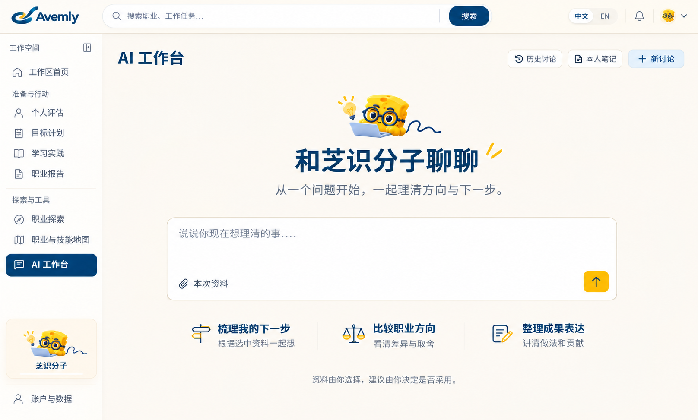
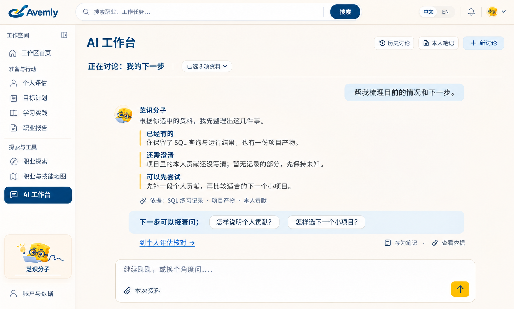
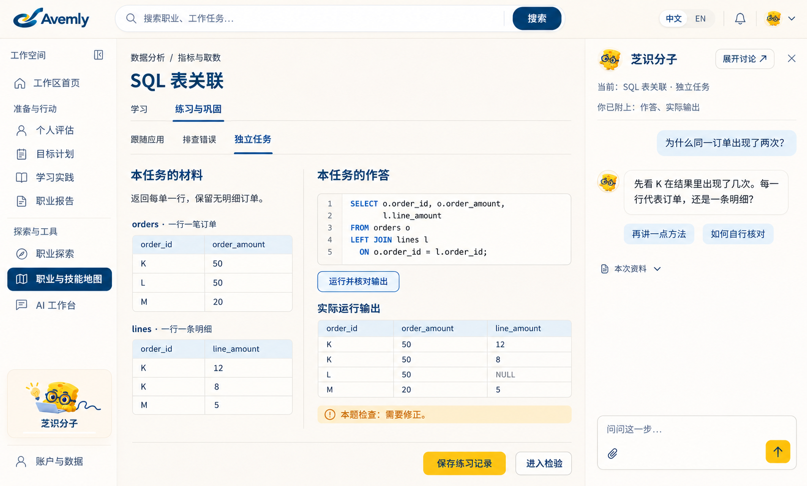

# AI 工作台：聊天优先设计包

日期：2026-11-21（北京时间）。当前状态：**已据此完成本地实施与隔离验证，未部署或推送**。

[本轮实施与验证](../../ai-workbench-chat-first-20261121.md) · [实际截图说明](actual/README.md)。下文及三张 concepts 图片保留为设计阶段交付；静态复核的四项缺口已在本轮处理，当前限制以实施说明为准。

## 使用顺序

1. 阅读[链路复核](链路复核.md)，了解当前四项缺口。
2. 分别看三张图；它们是同一设计的三个状态，不是三个风格选项，也不是网页实拍。
3. 阅读[界面规格与交互](界面规格与交互.md)，约束文案、状态和真实操作。
4. 将[还原实施提示词](还原实施提示词.md)连同本目录交给改网站的AI。实施提示词用于后续本地开发和验证，不授权生产部署或推送。

## 01 独立聊天首屏

自由输入为主体；三条问题起点只帮助开始，不构成必经流程。历史、笔记、新讨论明确可达；资料按需选择。无常驻任务模式、完整资料目录、计划编辑器或成果长表单。

## 02 情况总结与建议对话

由用户主动请求后，根据本次选中资料整理“已经有的、还需澄清、可以先尝试”。回答、来源与追问相邻；缺记录保持未知，建议按需交回原业务页核对。

## 03 学习现场AI侧栏

原学习页保留任务材料、代码、运行结果、保存与检验。AI围绕本步骤提供线索，可带同一主题进入独立讨论。本图仅展示SQL练习，不表示所有课程都已具备自动执行或个性化辅导能力。

## 设计阶段审核结论（历史）

可以交付本套待实现视觉设计；**现有网站尚不能称为全链路完整通过**。静态复核发现：

- 计划/成果草稿仍主要来自手填和原文拼接，未真正由选定建议形成。
- 更换资料后，旧成果草稿可能继续关联到新来源。
- 任务范围会写入，但影响预览未完整展示前后变化。
- 站内规则主要按意图返回线索，不能冒充理解自由问题的聊天。

这些问题要与后续还原一起修复，不能只换样式。具体源码位置、处理与验收见链路复核和还原提示词。

## 提示词与参考来源

- 三图由内置图像生成工具分别生成，没有压成多页拼图。
- 完整生图提示词：`prompts/01-chat-home.txt`、`02-chat-summary.txt`、`03-learning-sidebar.txt`。
- 01以旧工作台实拍作品牌/导航参考，使用现有角色；不延续旧主体表单。
- 02以本套01效果图作一致性参考。
- 03以01维持品牌，以旧SQL实拍作学习材料/布局参考；旧图绿色不作为当前配色，沿用最新蓝黄方向。
- 旧工作台实拍：`../ai-workbench-20261121/actual/00-overview.png`。
- SQL参考：`../skill-follow-20261120/actual/05-sql-output-checked.jpg`（历史实拍，不是当前版本最终验收）。
- 现有角色：`public/illustrations/workbench/ai-laptop.png`；现有Logo：`public/brand/avemly-blue-gold-20261030.png`。实现应复用资产，不从图中抠图替换Logo/角色。
- `generation-manifest.json`记录来源、最终文件、尺寸和摘要。

图片文字、答复、数据、资料数均为合成设计示例，不来自真实账户或真实模型调用。UI示意不表示外部模型已启用。

## 本轮检查范围

已完成：源码静态复核、逐张视觉检查、跨图一致性、SQL输入—查询—输出语义检查、交付文件核对。

本轮未修改业务源码，未运行网站测试、构建、浏览器或真实模型。前轮98项检查属于历史，不冒称本轮实测。未上线、提交或推送。

以界面规格和既有业务校验约束图中细节，尤其模型关闭、外发授权、草稿来源、未完成复核时的检验状态。
