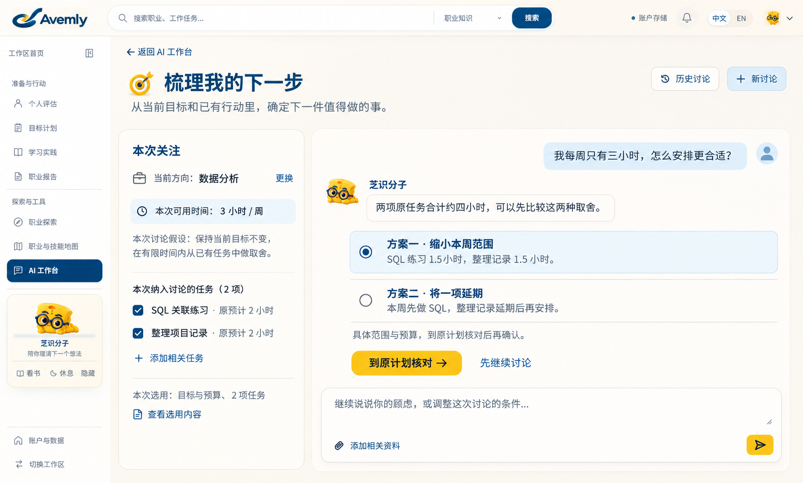
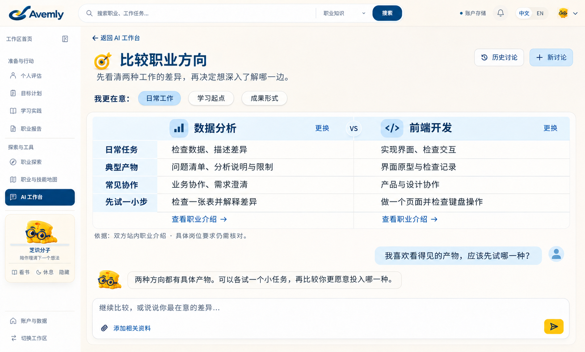
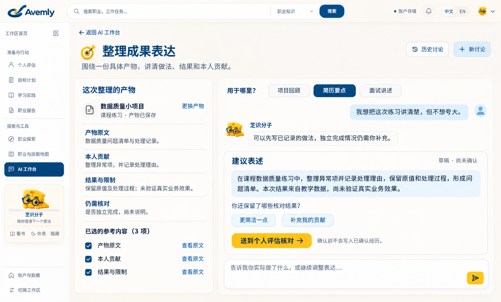

# AI 工作台：三个独立任务页设计包

日期：2026-11-21。最新状态：**已按本包在当前工程完成本地实现与隔离验证；未部署、未提交、未推送**。下文三图保留设计阶段含义，不冒称实际页面。

[本轮实现与验收](../../ai-workbench-task-pages-20261121.md) · [实现对应](implementation-map.md) · [实际截图](actual/README.md)

## 这次改什么

三个起点不再只切换意图后打开同一个资料目录。它们进入三个各自有清楚任务动线的页面，自由聊天首页保留：

| 入口 | 页面主线 | 后续操作 |
| --- | --- | --- |
| 梳理我的下一步 | 目标/本次时间假设 → 相关原任务 → 对话讨论取舍 | 到原计划核对具体建议，不在聊天重复排期表单 |
| 比较职业方向 | 明确A/B → 同维公开差异 → 聊最在意的取舍 | 看职业/尝试任务/保存结论，不自动切换目标 |
| 整理成果表达 | 一份产物 → 做法/结果/贡献/未知 → 表达建议 | 到个人评估形成待确认候选，不自动写简历 |

这是三个任务状态的页面，不是三个风格选项。来源以业务对象和可读部件呈现，不铺八类底层目录；主内容与操作直接可见，详细原文才按需查看。学习Tutor维持现有按需停靠。

## 01 梳理我的下一步

少量背景支撑聊天；区分本次假设和真实预算，方案尚未应用。图中2+2=4小时；方案一1.5+1.5=3小时。缩范围要连同目的和检查要求一起核对，不能只改小时数字。

## 02 比较职业方向

两种职业直接同维对照，个人材料为可选补充。例子取自站内数据分析/前端开发介绍，不是统一招聘门槛或个人匹配评分。

## 03 整理成果表达

围绕单份课程产物区分原文、贡献、限制和待核对项，再讨论用途和措辞。图中为保存的练习产物，不宣称项目已完成或用户独立完成。

## 交给实施AI

1. 先读[任务逻辑与查漏](任务逻辑与查漏.md)。
2. 逐张看上面三图，再读[图文与状态规格](图文与状态规格.md)。
3. 将[修改实施提示词](修改实施提示词.md)连同本目录交给负责改网站的AI。它要求完成本地实现与验证，暂不部署、提交或开启付费模型。
4. 完整生图词保存在 `prompts/`；三张用户截图原件副本在 `reference/`；文件和生成来源在 `generation-manifest.json`。

## 查缺补漏结论

- 当前实现确实是三个按钮共用同一资料目录；需要新增独立路由/页面编排与恢复状态，而不是只改样式。
- 现有资料指纹、六条近期消息、十二引用、具体建议→绑定稿→原业务预览确认已经实现，应复用。旧四项功能缺口已修，不能再当作本轮未修问题。
- 职业来源目前主要是技能树，比较页还需要从现有职业介绍补充工作/产物/协作等公开投影。
- 下一步编辑稿只支持选中的原任务，无原任务时应回既有创建入口，不能伪装已能新增。
- 任务切换、每页问题/来源恢复、私有路由、模型关闭和来源失效均需要独立验收，不能以图证明实现。

## 本轮检查范围

已读当前源码、根交接和近期验收；完成三个任务构思、独立查漏、三图逐张视觉检查与算术/文义检查，以及文件完整性核对。未运行网站测试、浏览器、构建或网站真实外部问答调用，未连接生产。

交接记载当前线上为17:44合并发布，本轮未重新实测线上。图由内置生图工具分别生成，全部是合成设计内容，不是实拍、真实用户资料或真实模型回答。网站业务源码、账号和生产状态未改；本轮只新增设计文档/图并更新交接。
