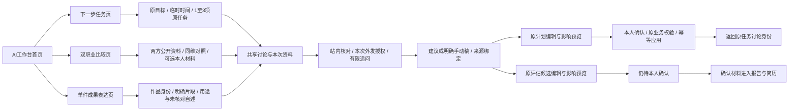

# 三任务页的实现对应图

本图为实现结构说明；原三张待实现效果图在 `concepts/`，实拍在 `actual/`，不互相冒称。

- 下一步与表达：准备区330px、较窄桌面300px，右侧单列讨论；不常驻三栏。
- 比较：两方与关注点在上，同维资料在中，讨论在下；英文维度列160px以保留完整词。
- 共享暖白、浅蓝、深蓝与黄色发送键，原角色、全站导航、真实登录及Tutor结构保留。
- 身份状态属于讨论记录；来源正文由服务端重建，用户假设不替代真实业务记录。
