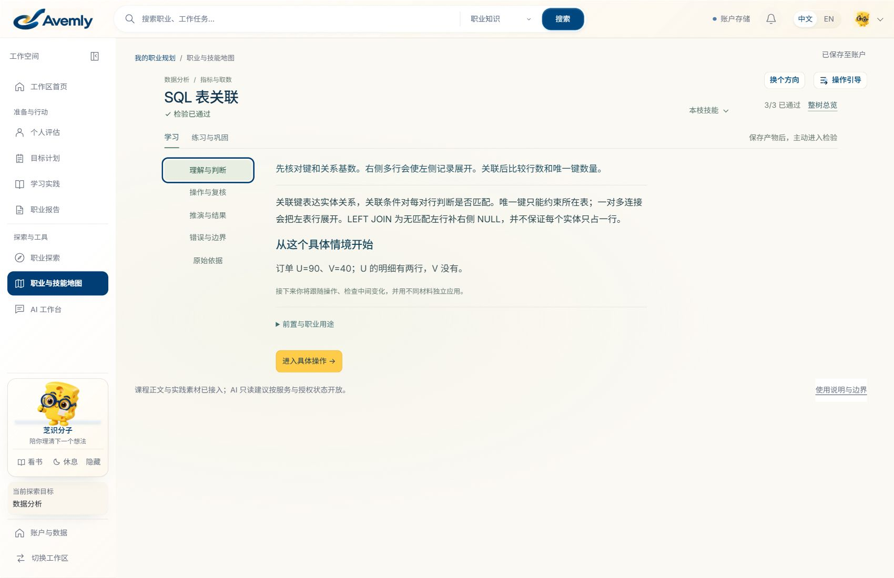
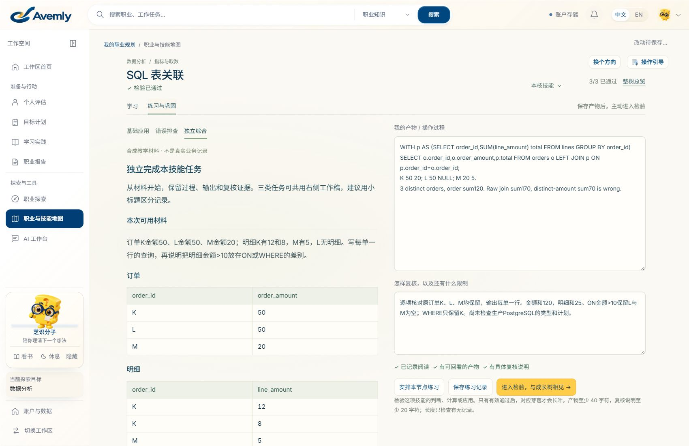
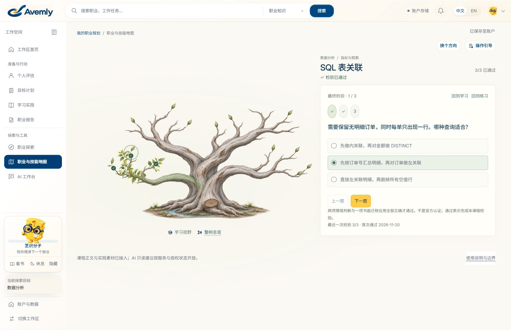
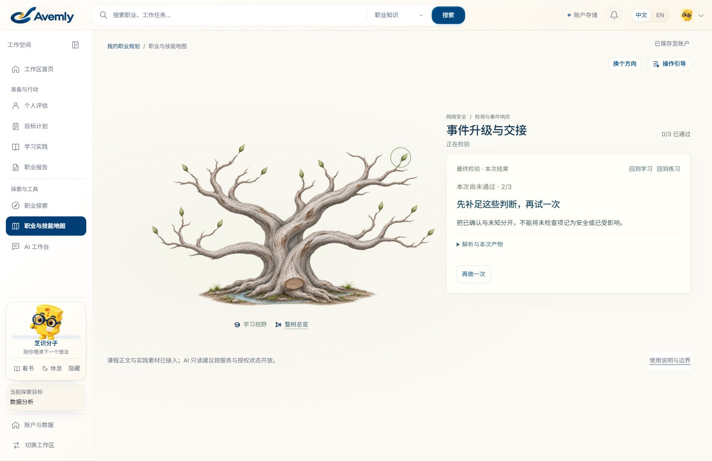
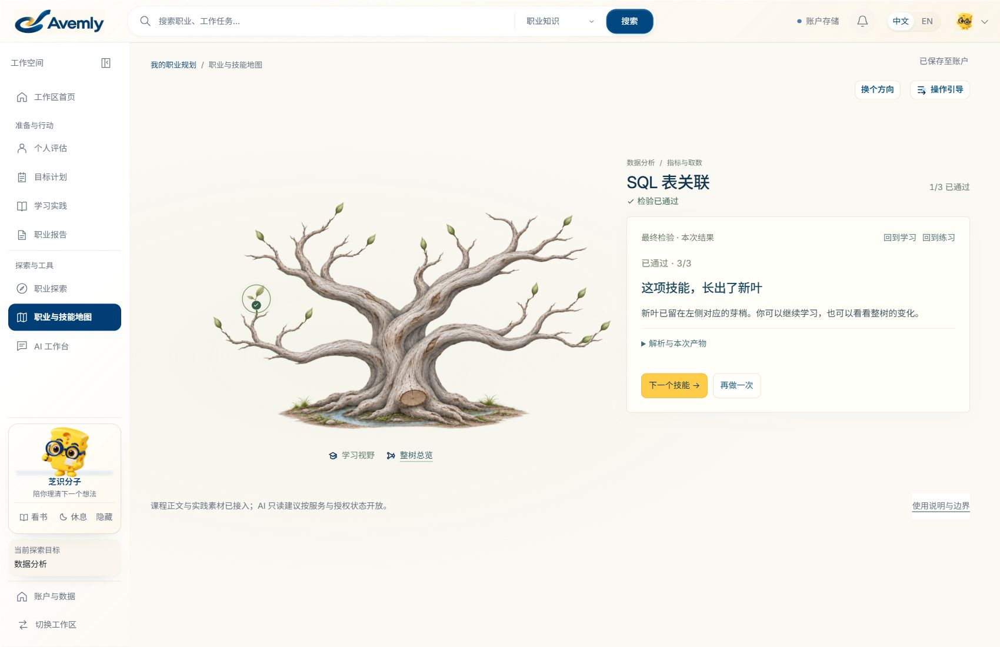

# 课程深化、实践工作区与成长检验构图

后续已由[问题教学与分任务练习版](skill-follow-20261120.md)更新。下文保留2026-11-20 11:12这一历史发布的实测范围。

2026-11-20 11:12（北京时间）已上线：`skill-depth-20261120-20261120T031225Z`。入口 [职业与技能地图](https://47.250.133.180/career-map)。前一版本 `skill-learning-20261120-20261120T014331Z` 保留。

继续沿用：**整树选技能 → 独立无树学习 → 独立无树实践 → 用户主动进入树旁检验 → 首次有效通过长叶**。本轮不改树图片、枝条几何、技能版本、服务端评分、账户记录和报告撤回状态。

## 从实际截图发现的问题与处理

优先查看了上一版 `skill-learning-20261120/actual` 的学习、完整操作示例、实践、检验、单项与整枝结果六种状态。主要问题是：正文被多层标题和导航推至较低位置；材料主要藏在下载中；树宽不足而题面很高；结果默认仍有多行详情，占用了过多空间。

[实施前构图示意](images/skill-depth-20261120/design/layout.svg)是线框示意，不是用户已确认效果图或实际截图。本轮实际截图见后文。

- 技能名成为主标题；职业/分支归属缩成一行，非错误保存状态放到轻量位置。本枝目录收为就近展开，阶段切换保留学习、实践两个入口。
- 1700px 实测教学正文从约 y=500 的旧截图位置提前到 **y=304.5**。正文为 **17px**；目录166px、正文最长约80ch，以空白和字号区分层级，正文不再重复一遍技能标题。
- 操作方法、输入表、代码、结果解释与复核条件邻接展示。代码可复制，简单矩形 CSV 用表格展示，原文可展开复制。长代码仅在自身区域横向滚动；没有给正文再建第二个竖向滚动区。
- 使用工作区原有的单一主阅读滚动区，目录吸附；长课另外保存滚动到代码位置的实际截图，不能把浏览器 fullPage 参数当成内部滚动内容已全部展开。
- 检验采用 **1.34:1（约57:43）**。1700px 实测树区781.5px、纸面583.2px、间距28px；1366px 实测590.2/440.4px。均匀缩放完整原树，保留根部，不拉伸、不裁枝。
- 树和纸面的视觉中心接近：1700px 时完整树框中心约 y=530.7，题面和结果纸面中心约 y=533–535。题面由内容决定高度；单项/整枝结果纸面约333px，解析与产物合为一个默认关闭入口。
- 树有独立、固定的布局锚点并在主阅读区内吸附。测试发现展开解析会把树从 y=310.8 带到421.6，已修正；最终解析收起/展开时树均为 **y=310.8**。自然滚动主阅读区时屏幕坐标会随滚动变化，不能把这个变化当布局抖动。
- 未通过时默认直接显示本次错误对应的原因；详细题目和产物按需回查。历史已通过后再次作答不覆盖已有成长。

## 123 项技能怎样深化

对照旧课程发现：**123 项技能的方法实际只有10个按职业共用的版本**，旧案例也复用了原有情境判断。现在站内教学改用逐项原创的概念、操作、输入→中间变化→输出、复核与限制；每项另有不同输入的独立任务与参考思路，旧领域模板不再作为正文方法显示。

原作者输入在 `src/i18n/skill-depth-entries.tsv` 和 `skill-depth-practice.tsv`，生成站内双语 `skill-depth.json`。一技能一条的旧方法复用数、旧任务、新知识、示例、练习、来源与执行边界记于 `checks/skill-depth-20261120/content-review.json`。字段完整和文字不重复仅作为结构检查，不能替代下列概念、示例及执行核对。

| 方向 | 本轮补足的具体知识与应用 |
| --- | --- |
| 数据分析（13项） | 队列/事件分母、观察成熟度；关联键/粒度/基数、无匹配行、放大、NULL与ON/WHERE；分组比率加权、缺值与缺记录、冲突裁决、质量规则分母、分布尾部、抽样框、实验效应尺度、维度键、透视刷新、图表编码与简报限制。 |
| 人工智能（13项） | 任务基线、字符串标识与日期解析、按实体/时间切分、只在训练集拟合、泛化差距、输出结构与业务有效性、证据缺失处理、工具写权限、指标成本、评测失败类型、复现清单、分群监测与人工接管。 |
| 网络安全（12项） | DNS/TCP/TLS/HTTP层次、信任链与内部一跳、授权范围、会话生命周期、逐请求对象授权、密钥撤销、日志时区与关联、分诊假设、事实/未知交接、信任边界、值参数与标识符白名单、拒绝路径回归。 |
| 运维（12项） | 服务账号读写边界、分层诊断、时间线因果限制、构建/运行分离、三类探针、基础设施替换风险、四信号、事件型SLO预算、trace关联、灰度对照稀释、回滚后的业务复核与可验收复盘。 |
| 前端（12项） | 原生表单和按钮类型、固有尺寸与长词溢出、事件委托/currentTarget生命周期、模态焦点、字段错误、异步竞态与response.ok、共享状态、锁文件构建、条件等待、现场分群P75、输出处理与CSP、上线核验。 |
| 后端（13项） | HTTP与幂等区别、schema/示例区别、层次与写入边界、并发状态迁移、NULL约束、事务与重试、EXPLAIN估计/实际与执行副作用、会话/对象授权、类型和值域、集成持久化断言、结果未知的重试、遥测基数。 |
| 数据工程（12项） | 粒度与可加性、SQL变换对账、多分区规格、timetable逻辑窗口、原子窗口替换、依赖闭包补数、水位和迟到策略、保留期与重放、修改/删除增量、失败行去向、Job/Run/Dataset、数据恢复与看板恢复的区别。 |
| 软件测试（12项） | 可观察验收、风险依据、测试层级、二值/三值边界、决策组合、非法状态转换、探索章程、最小复现、重测/回归区别、隔离数据、稳定断言、失败证据与重试门禁。 |
| 通用开发（12项） | 问题契约、可用切片、解析/领域边界、控制流非法值、集合顺序和成本、具体异常、边界单测、最小复现、保持行为的重构、三方合并意图、可执行评审意见、公开契约版本。 |
| IT交付（12项） | 现状/目标/假设、范围与变更、依赖责任、环境隔离、角色动作和对象范围、迁移对账、角色UAT、切换最晚回退点、门禁、真实任务培训、支持分流、运维与风险交接。 |

## 教学、实践、检验如何对应

SQL教学使用 U=90、V=40 与两条U明细：直接关联3行，总额误变220；先汇总后2行，总额130，再对比ON/WHERE。独立实践改为 K=50、L=50、M=20，明细K=12/8、M=5：正确订单总额120，直接关联170，`SUM(DISTINCT amount)`错误地变70。检验再用A/B/C的不同匹配数量，必须迁移关联基数规则，不能抄教学数字。

边界课区分二值与三值分析，教学整数范围18–60含端点；独立任务1–10，要求0/1/10/11、补2/9、普通5、空与小数。决策表另给会员/金额条件组合空表，要求独立写动作。事件交接以事实、假设、证据引用、责任人与更新时间组织叙述练习，检验已确认与未知不能相加。

实践有基础应用、错误排查、独立综合；起步提示、方法拆解、参考答案分别展开。输入表就地可见，代码/查询/表格/分析说明和复核理由可编辑与保存，同一技能共用工作稿，可用小标题分开。任务页明确区分：

1. 参考答案对照和本人自查；
2. 系统检查记录是否存在；
3. 最终服务端情境判断与迁移题的实际评分。

产物40字符、复核20字符仅是记录门槛。没有自动评审任意代码或自由说明，也没有因阅读、下载或保存而长叶。旧草稿、章节位置、作答、首次通过时间和不同职业进度继续使用原账户结构；本轮无迁移。

## 原始资料与核对范围

本轮实际阅读的针对性章节包括：

- PostgreSQL [§7.2 Table Expressions](https://www.postgresql.org/docs/current/queries-table-expressions.html) 中关联/ON/WHERE及外关联例子，[聚合与空输入](https://www.postgresql.org/docs/current/functions-aggregate.html)、[约束](https://www.postgresql.org/docs/current/ddl-constraints.html)、[EXPLAIN](https://www.postgresql.org/docs/current/using-explain.html)。核对公共SQL语义，执行环境与PostgreSQL原生功能分开。
- [scikit-learn common pitfalls](https://scikit-learn.org/stable/common_pitfalls.html) 的训练/测试预处理与泄漏；[MDN Fetch](https://developer.mozilla.org/en-US/docs/Web/API/Fetch_API/Using_Fetch) 的HTTP错误，及[currentTarget生命周期](https://developer.mozilla.org/en-US/docs/Web/API/Event/currentTarget)；[React状态选择](https://react.dev/learn/choosing-the-state-structure)；[W3C模态交互](https://www.w3.org/WAI/ARIA/apg/patterns/dialog-modal/)的初始焦点、Tab、Esc与返回触发器。
- [Kubernetes probes](https://kubernetes.io/docs/concepts/configuration/liveness-readiness-startup-probes/) 的三类职责与级联风险；[Airflow timetable](https://airflow.apache.org/docs/apache-airflow/stable/authoring-and-scheduling/timetable.html) 的触发式/数据区间式差别，明确Airflow3的默认行为，不能仅由cron推定昨天；[Iceberg evolution](https://iceberg.apache.org/docs/latest/evolution/)的新旧分区规格；Flink水位、OpenLineage运行模型及dbt数据测试的相应章节。
- [OWASP逐请求授权](https://cheatsheetseries.owasp.org/cheatsheets/Authorization_Cheat_Sheet.html)、参数化查询和密钥撤销；NIST SP800-63B-4会话和61r3事件分诊；SRE事件型SLO与灰度对照；[ISTQB CTFL4.0.1](https://istqb.org/wp-content/uploads/2024/11/ISTQB_CTFL_Syllabus_v4.0.1.pdf) §4.2.2二值/三值边界、决策表和状态转换；Python集合、异常、unittest，npm ci、Playwright等待/隔离、SemVer及Microsoft实施测试/培训/交接资料。

每课保留可回查的原始来源。97个来源另做章节片段提取：89个返回片段，6个不可取（2个ACSC/CISA、Ubuntu及3个SFIA），2份PDF经浏览器阅读。部分自动片段只是导言或目录，已在 `research-excerpts.json` 明确标为 **excerpted，不是全文审阅或运行验证**；关键规则依上列具体章节核对。Ubuntu自动提取失败后另用网页读取；SFIA等未据此声称已完整审读。没有职业专家审稿、真实学生学习效果研究或所有工具版本的执行背书。

## 实际执行的示例

详见 `checks/skill-depth-20261120/example-runtime.json`，脚本 `examples.py` 可复跑。

| 环境与内容 | 实际结果 | 尚未验证 |
| --- | --- | --- |
| Python3.14.2 / SQLite3.50.4，关联、ON/WHERE、NULL | 3行/220 → 2行/130；ON保留V、WHERE不保留；NULL比较与聚合符合预期 | PostgreSQL原生计划、类型、排序规则 |
| SQLite，汇总与缺失 | 0.12；4行、3有效、均值20 | 生产数据库数值类型/舍入 |
| Python，边界与变异 | 9案例通过；60检出故意写成`<60`的错误 | 真实产品年龄需求、穷尽全输入 |
| Python unittest | 普通与空列表2个测试通过 | 其他异常/类型契约 |
| pandas3.0.2 | 0017前导零保留；第二行无效、第三行缺失 | 混合格式、时区 |
| 算术复核 | 均值12/中位5、抽样权重0.68、迁移行数/金额对账正确 | Excel界面、真实调查与迁移工具 |

其他工具操作与非代码情境属于出处核对和纸面推演，未写成“均已运行”。课内环境说明与此范围一致。

## 实际页面

以下均为本轮server构建、真实本地业务后端和隔离合成账户的实际页面；不是GPT效果图，也不是生产用户成绩实拍。保留完整浏览器画面，长内容另附主阅读区滚动截图。

| 学习首屏 | 独立实践工作区 |
| --- | --- |
|  |  |

| 树旁检验 | 未通过的具体补足 |
| --- | --- |
|  |  |

| 单项长叶 | 整枝成果 |
| --- | --- |
|  |  |

[完整大树](images/skill-depth-20261120/actual/01-tree-overview.jpg) · [操作/输入表](images/skill-depth-20261120/actual/03-sql-deep-method.jpg) · [滚动后的代码](images/skill-depth-20261120/actual/22-sql-code-scrolled.jpg) · [短课程](images/skill-depth-20261120/actual/11-short-lesson.jpg) · [1366检验](images/skill-depth-20261120/actual/12-assessment-1366.jpg) · [职业选择](images/skill-depth-20261120/actual/13-career-choice.jpg) · [边界方法](images/skill-depth-20261120/actual/14-boundary-method-1366.jpg) · [错误排查](images/skill-depth-20261120/actual/15-boundary-debug-1366.jpg) · [决策表实践](images/skill-depth-20261120/actual/16-decision-table-practice.jpg) · [事件交接推演](images/skill-depth-20261120/actual/17-incident-walkthrough.jpg) · [英文1920](images/skill-depth-20261120/actual/18-english-1920.jpg) · [英文实践](images/skill-depth-20261120/actual/19-incident-practice-en.jpg) · [英文检验](images/skill-depth-20261120/actual/20-assessment-en-1920.jpg) · [展开解析](images/skill-depth-20261120/actual/21-expanded-review.jpg) · [恢复整树](images/skill-depth-20261120/actual/23-grown-overview-restored.jpg) · [页面核验](images/skill-depth-20261120/actual/verification.json)

## 验证与发布

- Node24：相关14项全部通过，涵盖原123技能/检验、历史记录、准备门槛、相机完整性/固定锚点以及新增课程与SQL实际语义。全量509项：505通过、3失败、1跳过；失败仍为已有AI预算定价快照过期，不宣称全绿。没有修改费用开关或快照。
- 双语8512条、exactMissing=0；server构建438模块通过；已有大chunk和登录双重导入提示保留。最后CSS锚点修正后重建并实际复核展开/收起。
- 桌面1366/1700/1920，中英文；短课、长代码、表格、叙述型任务，准备与保存、主动检验、未过不授叶、单项/整枝、刷新及跨方向恢复、历史不重播均检查。页面错误日志为空，未测试移动端。单芽和整枝传导中实际捕获water阶段；静态截图不能替代全时序测量，时长规则沿用980/1550ms。
- 包含11文件，258862字节，SHA-256 `fcf54030583b7ef252a701306e94191429dffd2fdb42142a78e8a28b6842b902`。检查前一release、4个更新文件摘要、29个原依赖与报告撤回基线后，服务器隔离副本运行14项、双语和构建，原子激活，回执 `DEPLOY_OK`。
- 本轮纯前端发布，未修改数据库、后端、服务配置或重启后端，PID保持；旧成绩与真实账户未重新提交。报告V2仍撤回。旧发布与原文件备份保留；生产失败回退未触发，不宣称实测回退。
- 服务端及本机独立HTTPS检查五路由、16资源、健康API通过，所有资源与最终本地构建逐字节一致。证据见[生产回执](skill-depth-production-20261120.json)。备份 `/srv/career-growth/backups/skill-depth-20261120-20261120T031225Z/`。
- 自建预览和浏览器已关闭，端口63760不再监听。源码没有提交或推送Git。
