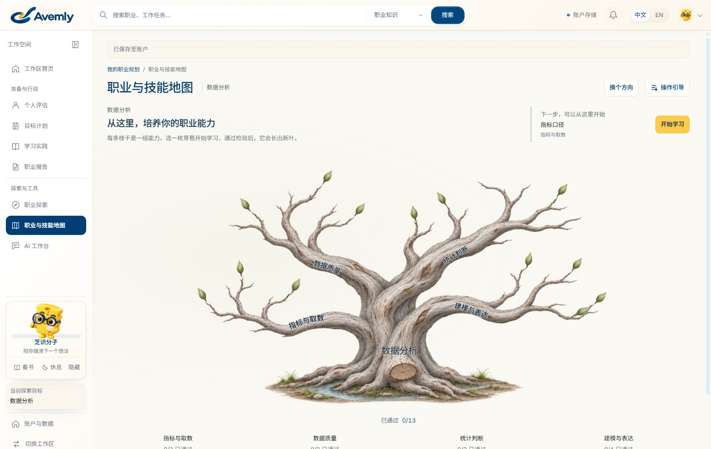
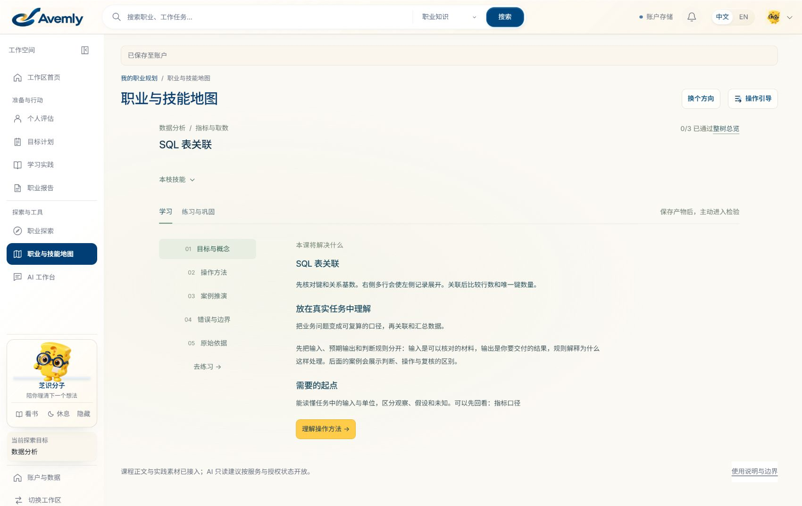
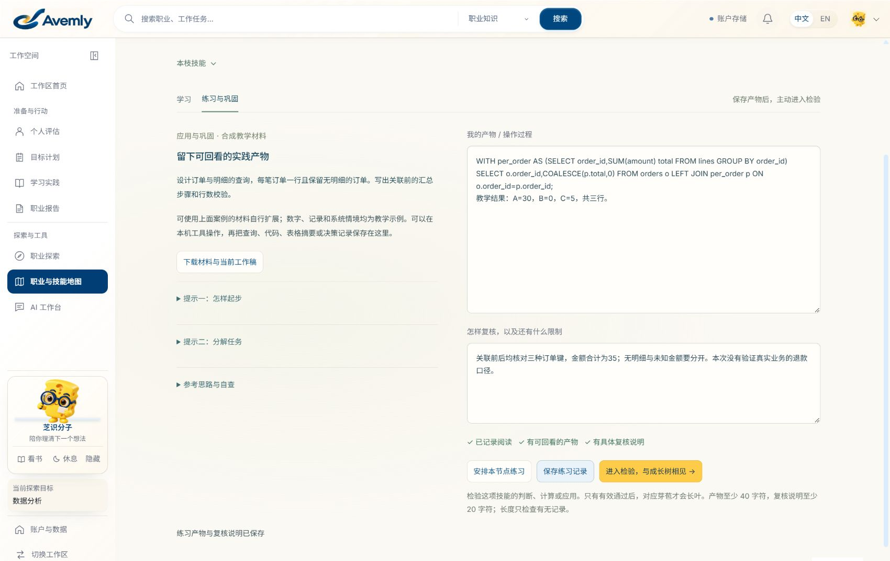

# 独立学习、实践与树旁检验

后续基线：2026-11-20 11:12 的[课程深化与检验构图](skill-depth-20261120.md)已在保留本流程和评分规则的基础上上线。本文保留为09:43阶段的历史记录；本轮实测以新文档为准。

2026-11-20。已于北京时间 09:43:31 发布 `skill-learning-20261120-20261120T014331Z`。本轮围绕“整树选择 → 独立学习 → 独立实践 → 主动进入同屏检验 → 有效通过长叶”重组现有 `/career-map`。路由和账户体系复用，学习与实践采用独占工作区的页面状态。

## 页面与连续性

- 整树负责方向、枝条、技能定位与成果回顾。自然树形、木纹、芽苞、叶片、土壤浅溪的图片未修改。
- 学习与练习不挂载树组件，没有缩小树、悬浮树或树形背景。学习采用左侧目录与舒适宽度正文；实践展开材料、分层提示、产物编辑与复核说明。
- 目标、职业方向和分支在正文前集中呈现；当前课目录、技能、步骤和原有视野恢复机制衔接。记录阅读只是过程状态，不能自动计为通过。
- 主动进入检验前保存产物和复核说明；检验变为透明左树与右侧纸面。一次显示一题，结果替换题面，解析与参考产物按需展开，不把题目、解析和结果全部纵向叠加。
- 未通过可返回对应案例或操作方法，恢复此前产物；下一项重新进入无树学习。首次有效通过沿原路径传导、长叶，整枝返绿和叶簇保持。刷新与切换方向不重复播放历史成果。

[实施前流程与构图示意](images/skill-learning-20261120/design/flow.svg)明确标记为示意，以下均为实际页面。

## 教学内容、材料与依据

123 项技能均补入双语站内教学组织：目标与起点、方法、两项带理由的案例推演、错误路径、适用限制、实践任务与原始依据。案例来自原有已编写的教学情境，经本轮重新组织为示范；最终还需完成新输入上的迁移任务。十职业的公共方法按领域组织，技能目标、案例、实践与迁移内容各自对应，未宣称每项已成为独立完整职业课程。

另有 14 个完整可操作示例，覆盖口径卡、SQL 关联与汇总、缺失与冲突、星型模型、pandas 准备、语义表单、DOM 事件、事务、幂等批处理、边界值、单元测试和迁移对账。SQL 关联示例已在 SQLite 执行得到 A=30、B=0、C=5；Python 示例完成语法检查。没有将本机语法检查冒称已验证所有工具版本。

实践可下载材料与当前草稿，可保存查询、代码、表格摘要、步骤和复核说明。旧纯文本草稿原样保留；新结构写入同一账户私有草稿字段，容量从 1800 提至 12000 字符，含转义长度约束。没有新增数据库表或迁移历史成绩。个人原文不随界面语言翻译。

来源优先采用官方规范与原始资料，课内保留 publisher、标题、原 URL 与既有版本标识。此次浏览核对了 [PostgreSQL 的关联语义](https://www.postgresql.org/docs/current/tutorial-join.html)、[事务](https://www.postgresql.org/docs/current/tutorial-transactions.html)、[scikit-learn 泄漏防范](https://scikit-learn.org/stable/common_pitfalls.html)、[OWASP 逐请求授权](https://cheatsheetseries.owasp.org/cheatsheets/Authorization_Cheat_Sheet.html)、[Google SRE 的 SLO 与预算](https://sre.google/workbook/implementing-slos/)、[React 状态提升](https://react.dev/learn/sharing-state-between-components)、[Airflow 逻辑窗口](https://airflow.apache.org/docs/apache-airflow/stable/core-concepts/dag-run.html)、[ISTQB 4.0.1](https://istqb.org/wp-content/uploads/2024/11/ISTQB_CTFL_Syllabus_v4.0.1.pdf)、[Python 数据结构](https://docs.python.org/3/tutorial/datastructures.html)、[unittest](https://docs.python.org/3/library/unittest.html)、[pandas 日期解析](https://pandas.pydata.org/docs/reference/api/pandas.to_datetime.html)、[MDN currentTarget](https://developer.mozilla.org/en-US/docs/Web/API/Event/currentTarget)及实施测试策略等代表性出处，涉及动态文档时在站内明确要求核对环境版本，不把最新 URL 当成固定软件版本保证。

93 个不同来源另做了链接访问和页面身份核对：88 个直接返回 200，2 个 ACSC 来源超时、3 个 SFIA 来源拒绝自动请求（403），未将访问失败等同于内容错误或编造“已全文审查”。详细记录在 `checks/skill-learning-20261120/source-audit.json`。本轮没有独立职业专家审稿或真实学生试用，不作此类背书。

## 有效检验与边界

每技能保留两项情境判断，新增一项服务端持有答案的书面迁移应用，共 3 项，全对才通过。迁移任务包括计算、输出推断、边界组值、配置/语义判断等；不是把前端“完成”按钮当成绩。公开技能接口不返回迁移答案。

服务端要求未通过技能具有已保存的阅读过程、实践产物和复核说明。产物至少 40 字符、复核至少 20 字符，只确认准备记录存在；自由产物不做自动语义评审，长度和自查不证明掌握，界面中已说明。最终能力反馈仍来自服务端有效检验。已有历史通过不撤销、不强迫补做新课，首次通过时间保持。

本轮没有通用代码执行沙箱或对任意产物的专家评分；代码/查询可在本机工具操作，保存过程并结合迁移题验证核心规则。不能据此宣称用户具备官方认证或生产工作胜任力。

## 实际页面截图

来自本轮 server 构建、真实本地业务后端与隔离合成账户。实际完成 SQL 关联、分组汇总、指标口径三项实践和服务端检验，包括一次迁移未通过。不属于 GPT 效果图或生产真实用户答题实拍。

| 完整大树 | 独立学习 |
| --- | --- |
|  |  |

| 独立实践与产物 | 返回树旁逐题检验 |
| --- | --- |
|  |  |

| 单项长叶与结果 | 整枝返绿与结果 |
| --- | --- |
|  |  |

[可操作示例](images/skill-learning-20261120/actual/03-hands-on-lesson.png) · [未通过](images/skill-learning-20261120/actual/06-application-needs-review.png) · [单芽传导中](images/skill-learning-20261120/actual/07-single-growth.png) · [整枝展开中](images/skill-learning-20261120/actual/09-branch-unfolding.png) · [1366px 结果](images/skill-learning-20261120/actual/11-narrow-result.png) · [英文实践](images/skill-learning-20261120/actual/12-english-practice.png) · [成果回顾](images/skill-learning-20261120/actual/13-grown-overview.png) · [浏览器核验](images/skill-learning-20261120/actual/verification.json)

## 验证与发布记录

- Node 24.22.3：相关 12 项全部通过，涵盖 123 项课程/迁移题双语与唯一性、答案不公开、迁移未过不能授叶、历史草稿与章节/答案恢复、服务端准备条件、幂等回执、并发冲突与历史通过保留。
- 全量 507 项：503 通过、3 失败、1 跳过。三项仍为原有 `AI_BUDGET_PRICE_EXPIRED` 预算集成失败，未改费用快照、预算账本或外部服务开关；不宣称全量全绿。最后状态文案及长度保护补改后，相关 12 项再次通过。
- 双语 8497 条、exactMissing=0；server 构建 434 模块通过，原有大 chunk 和登录组件双重导入提示仍在。差异检查通过。
- 浏览器实测 1366/1700/1920px、中文与英文、下载、无树学习/实践、准备门槛、逐题判断、书面应用、未通过复核、首次授叶、三技能整枝、刷新不重播、记录恢复与方向切换。错误日志为空；未专项检查移动端。
- 限定包 16 文件、211852 字节，SHA-256 `6cae868269b167319356bfa050558049a8c5fb8b511ea0ba9ddccbbe3fd34a53`。核对前一发布、8 个更新文件基线、17 项依赖及报告撤回基线后，在服务器隔离副本运行相关 12 项测试、双语和构建，再应用限定文件并原子激活，回执 `DEPLOY_OK`。
- 本轮涉及服务端检验规则，已在受限备份目录完成 SQLite 一致性备份，重启服务并核验就绪与新 PID。没有迁移、覆盖或清空生产账户数据，也没有重新上线报告 V2、改费用账本或外部开关。旧发布保留，失败回退未触发，不宣称生产实测回退。
- 服务端五路由、16 资源与 API 已通过；本机独立核验见[回执与独立 HTTPS 核验](skill-learning-production-20261120.json)。生产未创建测试用户或提交检验，实际流程截图来自本机隔离账户。自建预览已关闭。源码未提交或推送 Git。
