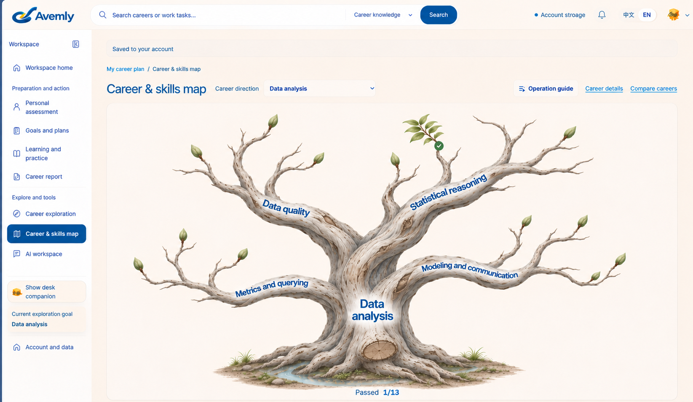

# 职业成长树 · 最终设计稿

树形素材继续沿用本稿；最新页面布局和生产状态见 [方向选择与侧边学习体验](skill-tree-journey-20261119.md)，生产已于同日 22:00 更新。

日期：2026-11-19。状态：用户已确认本最终设计，桌面网页及单芽/整枝动效已实现、验收并上线。当前生产发布为 `skill-tree-roots-20261119-20261119T123026Z`，最新实现、实际截图及生产核验边界见 [桌面还原与动效验收](skill-tree-implementation-20261119.md)。本稿覆盖此前对照稿中的规则四臂、偏黄木色及过扁树冠。

生成方式：内置 GPT image_gen，两步完成树形重绘及节点/边距校正。[完整提示词组](images/skill-tree-roots-20261119/concepts/06-prompt-set.txt)。[用户本轮指出枝干均匀的参考图](images/skill-tree-roots-20261119/references/02-user-uniform-branch-feedback.png)。本图是设计稿，不是网页实拍。

## 树形与材质

保留四个业务分支的身份和相对方位，以不同粗细、不同出枝高度和不等长的自然枝条承载。右上主枝承接树干的主生长方向，左上次之；左下较细、较长、略下探，右下从不同高度伸出并带局部转折。各分叉的两支粗细不同，木材随枝长逐渐收尖，次级枝条间距、长短、角度错落。根部同样采用不同长度与厚度，避免等距放射。

整体保持宽展和挺拔，宽屏目标为可见树冠约占卡片八成多，树梢与卡片边缘留空。节点、木纹、叶片、文字需按自然比例呈现，不做整图横向或纵向拉伸。原树的业务拓扑和节点归属保持，视觉重绘允许统一调整坐标以承接本轮要求的自然枝形。

枯木以工程原 `src/assets/skill-tree/ash-tree.webp` 为颜色参考：银灰、低饱和灰褐、蓝灰凹槽阴影，局部木节与细密纵向木纹。去除黄、金、蜂蜜色倾向；绿色集中于芽苞、新叶、少量草。暖白工作区背景继续沿用。

## 芽苞、根部与进度

13 个技能位置对应：左下 3、左上 3、右上 3、右下 4。本图示例为 12 个合拢芽苞、1 个已展叶节点，显示 1/13。芽苞短叶柄接在细枝上，方向随枝条，不放玻璃珠或金属托。枝名贴合各自主枝，职业名在主干；根部保留自然木节承接已有年轮设计。实现时应使用实时文本与账户进度，不把图中文字和示例进度烘焙成产品事实。

根下为低矮、不规则的灰褐土壤，浅溪从根前弯过，草与苔疏密不均。初始保留大部分土壤，按总体成长进度逐渐增加绿意，始终露出根、土和水面。地面不铺满卡片，不做高土堆或整片草坪。

## 达标动效规格

- 单节点达标，总长 0.8–1 秒：水边一圈浅涟漪 → 柔和拖尾亮线从靠水根部出发 → 贴着根、主干与目标枝条传导，分叉只走目标路径 → 抵达后芽从叶柄处展开一两片嫩叶，邻近一小段枝条逐渐泛绿 → 亮线消退，新叶保留。
- 整枝达标，总长 1.3–1.6 秒，包含最后一枚芽的展开：随后从该枝与主干的连接处向枝梢逐段返绿；叶簇从各自叶柄位置分批舒展，方向错落，其他枝条保持状态。
- 每次首次达标播放一次，平时静止。刷新、切换分支或重新进入页面不因已有进度重播；保留已长出的叶和已完成状态。减少动态效果时直接呈现结果。

## 本轮核对与后续还原边界

已视觉核对本图的主次枝粗细差异、错位分叉、自然收尖、灰褐木色、树梢边距、13 个节点分组及低矮根部场景。第一张生成稿出现多余芽苞，第二步已按 3/3/3/4 校正，本文件只引用校正后的最终图。

本节记录设计阶段的视觉核对，生图的像素与坐标不是网页布局验收结果。后续还原已制作分层素材，将木材、芽苞、叶簇、路径、年轮和实时文字分别承载，并以最终素材的实际叶柄与枝干曲线校准交互与光线路径；没有用整张页面图替换产品。实测结果及限制以上方实施验收记录为准。
