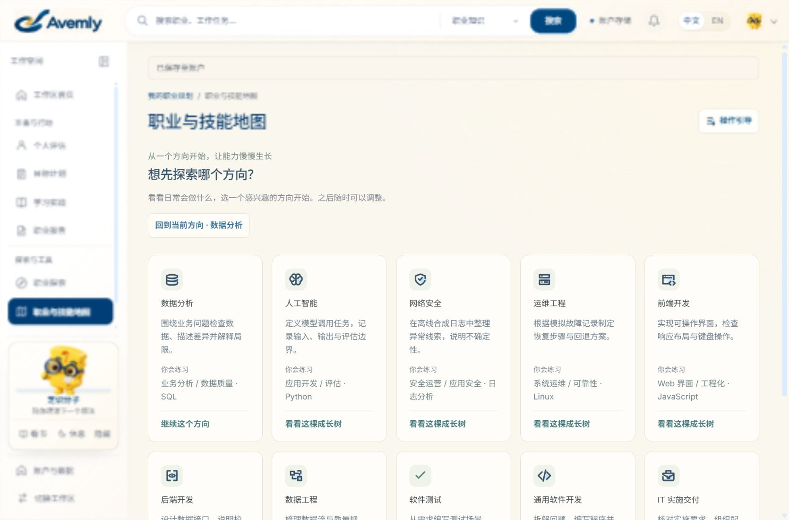
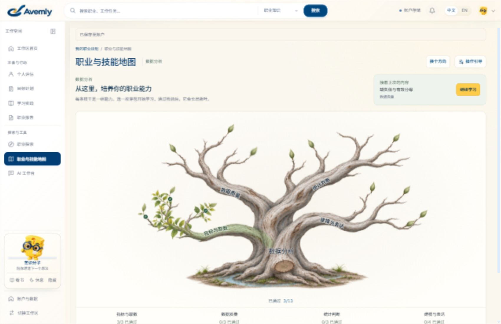
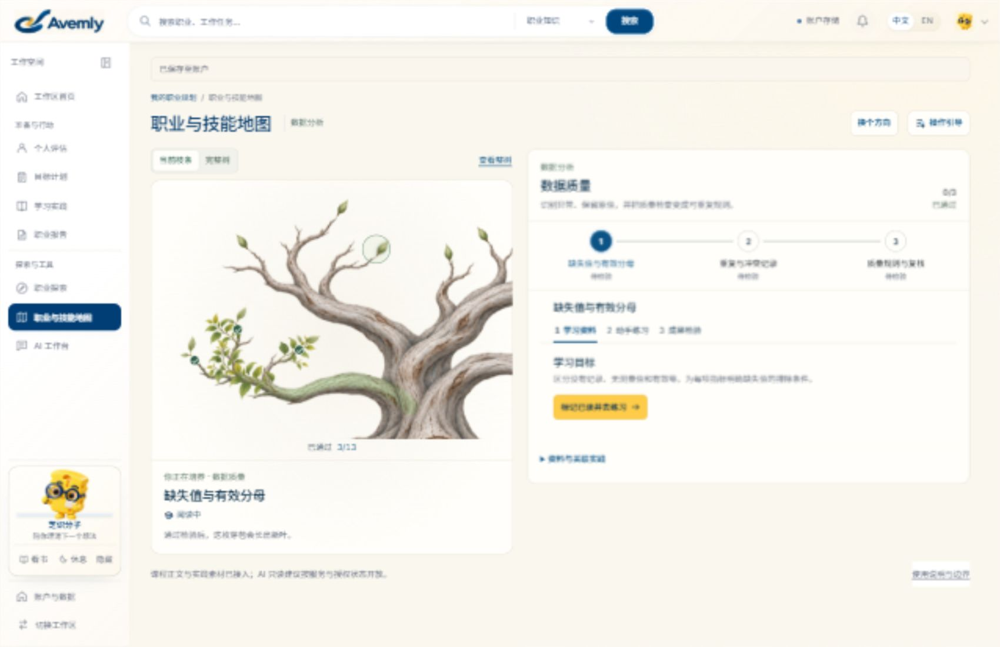
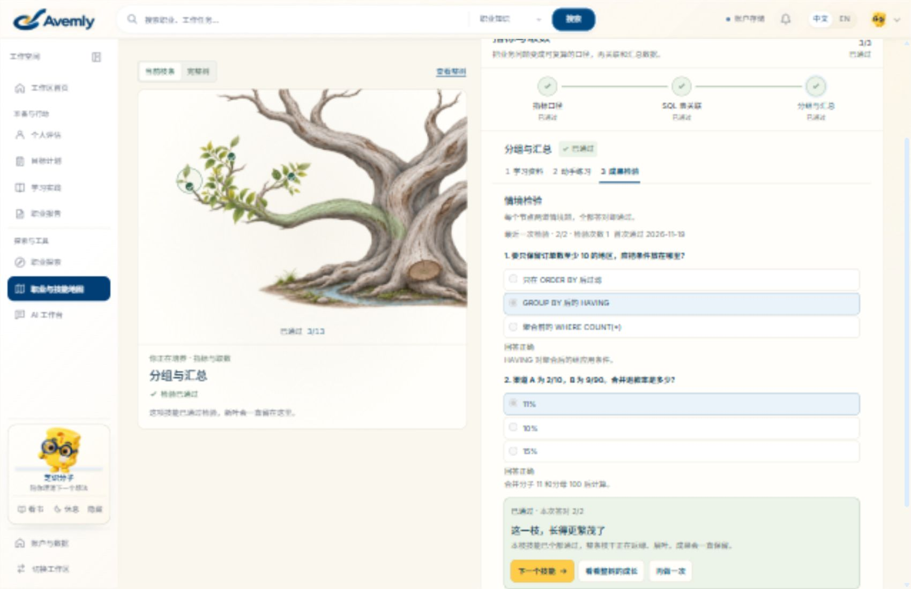

# 从选择方向到看见成长

后续更新：本轮布局已由 [树旁学习的连续空间](skill-tree-space-20261119.md) 接续，透明整树、共同背景和集中信息层级已于 23:00 上线。以下保留 22:00 发布当时的设计与验收记录。

2026-11-19。已于北京时间 22:00:39 发布，当前版本 `skill-tree-journey-20261119-20261119T140039Z`。前一发布 `skill-tree-roots-20261119-20261119T123026Z` 保留。

## 体验设计与实现

在现有 `/career-map` 内完成三种状态，没有增加一组独立业务页面。原树、木纹、枝干、芽苞、双叶和根部土壤浅溪的图片文件均未改动。

- **选择方向**：没有目标或学习记录时先看十张职业卡片，每张展示日常任务、练习能力和探索入口。已有目标、评估方向、明确深链和学习记录合理承接；方向可调整，探索不会静默覆盖目标计划。
- **整树总览**：保留自然整树与四组能力，舞台上限 1120px 并结合桌面高度约束；继续学习入口在树上方，也可直接点击枝干或芽苞。
- **左树右学**：同一棵树自然收至左侧，右侧展开现有学习步骤。默认聚焦当前枝条并保留主干连接，树下明确显示所属枝条、当前技能和状态。交互目标约 44px。切换步骤不反复移动布局。
- 左侧可以在当前枝条与完整树间切换；缩小的整树提供正常字号的枝名按钮，不强塞小字。返回总览会回到页面上方。左树随正文保持可见，树和学习区都没有额外的正文滚动区域；资料和关联实践按需展开。

[实施前结构图](images/skill-tree-journey-20261119/design/layout.svg)与下方实际截图分开保存。结构图不是实际截图；树形继续沿用此前用户已确认的最终设计和原素材。

## 进度、生长和恢复

阅读、练习和检验状态复用原账户 `skillStudy`。阅读和保存练习只表达过程，不计为通过；服务端 `skill.check` 及通过条件没有改变。

首次有效通过时，右侧保留结果，左侧自动播放沿根、主干和对应枝条传导、芽苞舒展及双叶展开，无需返回树区。单芽反馈 980ms；最后一芽后，900ms 开始同枝返绿与叶簇展开，整枝反馈 1550ms，并轻微拉远视野。其他枝条不动，完成后保留成果。

反馈等待相应通过记录真正提交到视图，处理命令回执与 React 更新的先后差异。刷新、返回或换方向不重播历史成果。减少动态效果时直接展示最终生长状态。

最近职业、技能、步骤、总览/学习模式和枝条/整树视野按账户、职业分别记在本机浏览器。真实阅读、练习和成绩仍随账户保存。跨设备没有视野缓存时按目标及真实记录提供续学点，不宣称视野已跨设备同步。未提交的答案不冒充通过记录。

## 实际页面截图

来自本轮服务器模式 React 构建、原业务后端和本机隔离合成账户的真实操作，**不是 GPT 效果图或生产真实用户实拍**。本轮从零开始完成了指标与取数枝条；总览保留三项通过记录，侧边图另展示上层数据质量枝条的聚焦效果。

| 职业选择 | 整树总览与下一步 |
| --- | --- |
|  |  |

| 左树右学 | 整枝成长与检验结果 |
| --- | --- |
|  |  |

[单项新叶与结果](images/skill-tree-journey-20261119/actual/04-single-growth-feedback.png) · [水分传导中](images/skill-tree-journey-20261119/actual/05-water-travel.png) · [整枝展叶中](images/skill-tree-journey-20261119/actual/06-branch-growth-feedback.png) · [窄桌面滚动末尾](images/skill-tree-journey-20261119/actual/08-narrow-desktop-whole-tree.png) · [英文学习](images/skill-tree-journey-20261119/actual/09-english-side-learning.png) · [浏览器核验明细](images/skill-tree-journey-20261119/actual/verification.json)

## 本轮验证和发布证据

- Node 24.22.3：方向/位置恢复 4 项、技能树业务 3 项、工作区引导 8 项、逐步操作引导 11 项，共 26 项通过。双语 exactMissing=0；server 模式构建 428 模块通过；差异检查通过。仍有原有 chunk 大小与登录组件双重导入提示。
- computer-use 实测：职业选择、总览、焦点衔接、阅读、保存、首次通过、最后一芽与整枝阶段、刷新不重播、方向及位置恢复、十方向 123 节点独立、中文/英文、1366/1700/1920 桌面，页面错误日志为空。窄桌面长内容末尾仍能完整看见左树，当前枝条三个目标都在视野内、约 44px。
- 没有本轮移动端或生产真实账户重新答题验收，也没有重跑历史 498 项全量回归。旧三项 `AI_BUDGET_PRICE_EXPIRED` 失败未修改；未改预算账本或启用外部模型。
- 限定前端包 11 文件、177170 字节，SHA-256 `85f6e35ecc84f0702b5939920d48f6f16b30280eaa9810468710b57ff541eaa7`。先核对现有发布、七个原文件及树依赖，再从服务器现有源码隔离构建并原子激活，回执 `DEPLOY_OK`。
- 服务端五路由、16 资源、API 和后端 PID 检查通过。本机独立 HTTPS 再核，16/16 构建资源与实际浏览器验收版本逐字节一致；HTML 仅最后换行存在 Windows CRLF / Linux LF 差异。
- 原报告撤回基线、账户数据库、后端代码与开关保留，未重启后端。备份与回执：`/srv/career-growth/backups/skill-tree-journey-20261119-20261119T140039Z/`；失败回退未触发，不宣称生产实测回退。
- [生产回执与独立 HTTPS 核验](skill-tree-journey-production-20261119.json)。本轮自建浏览器预览页和服务已关闭，端口 64788 已确认关闭。源码未提交或推送 Git。
