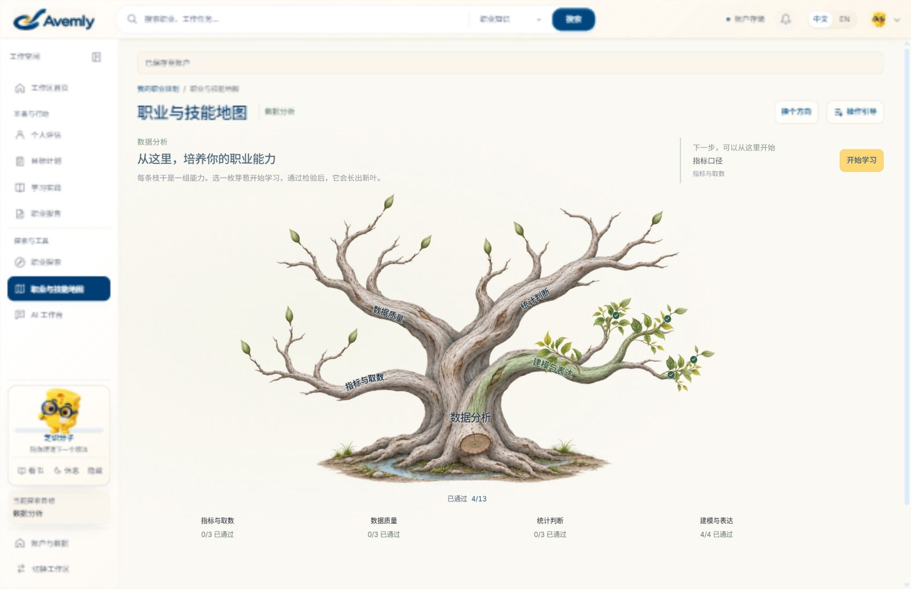
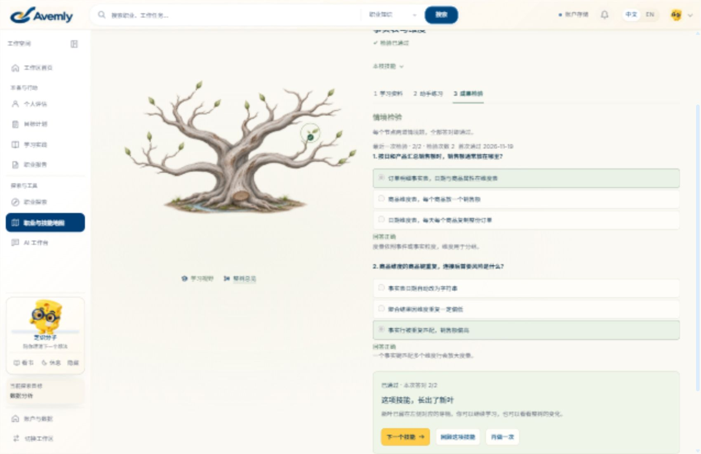
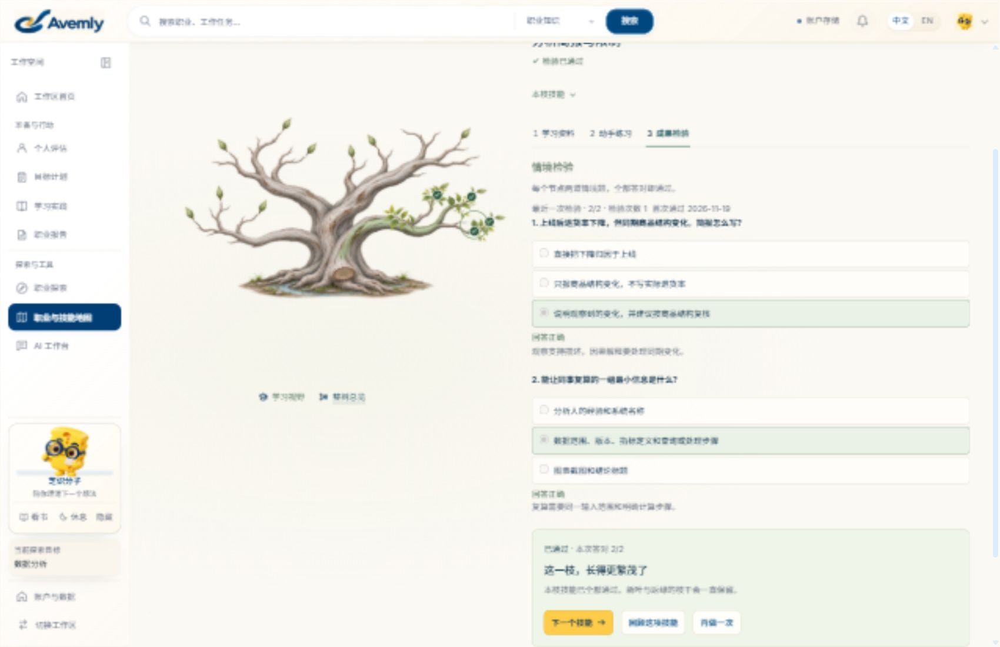

# 在树旁学习：连续背景与眼前成长

后续更新：[独立学习、实践与树旁检验](skill-learning-20261120.md)已于 2026-11-20 上线。用户新方向将完整学习和实践移至无树页面，树旁布局保留给最终检验。以下为此前共同学习空间的历史验收。

2026-11-19。已于北京时间 23:00:40 发布 `skill-tree-space-20261119-20261119T150040Z`。本轮仅调整现有 `/career-map` 的前端空间与信息层级。原自然树形、冷灰木纹、枝干、芽苞、双叶、土壤与浅溪图片均未改动。

## 构图与操作

- 树外框、卡片底色和矩形裁切取消，树与正文共用连续的浅色背景。总览仍完整展示整树和下一步入口。
- 学习时同一棵树收至左侧，右侧承接阅读、练习和检验。按桌面实际空间等比适配整个树形，避免旧版放大窗口切断枝梢与根部。当前芽苞保持约 44px 的操作目标，叶片适度放大便于辨认。
- 树有少量横向延伸，叶片可以进入内容的空白边缘。正文前留有净空，题目、输入与按钮周围不放装饰。左树随单一页面滚动保持可见，两侧没有独立正文滚动条。
- 技能名称、所属方向和枝条、通过状态集中在右侧。左树通过位置和轻微环线定位当前技能；树下只保留学习视野标识和一个整树总览入口。
- 本枝技能按需展开为简洁目录；资料仍按需展开。取消旧目录的横向连线。返回总览、切换芽苞和继续学习沿用既有路由与位置恢复。

[实施前构图示意](images/skill-tree-space-20261119/design/shared-space.svg)与实际页面截图分别保存，示意图不是网页截图。

## 成长规则

继续复用服务端有效检验记录与原生长控制。阅读、保存练习和未通过只表达过程，不生成叶片。首次有效通过时，检验结果与侧边传导、芽苞展叶同时可见；980ms 单芽反馈、1550ms 整枝反馈保留。

最后一项通过后，当前枝干返绿并展开叶簇，视野稍微拉远，右侧仍停留当前结果，不自动跳到下一项。刷新或切换技能后保留成果，不重播历史完成。原学习记录、计划入口和中英文切换保留。

## 实际页面截图

以下来自本轮 server 模式构建、原业务后端和本机隔离合成账户的真实操作，**不是 GPT 效果图，也不是生产真实用户答题实拍**。

| 完整总览与已有成长 | 共同背景中的学习 |
| --- | --- |
|  |  |

| 单项长叶与结果 | 整枝完成与结果 |
| --- | --- |
|  |  |

[单芽展开中](images/skill-tree-space-20261119/actual/03-single-growth.png) · [整枝展开中](images/skill-tree-space-20261119/actual/05-branch-unfolding.png) · [1366px 滚动末尾](images/skill-tree-space-20261119/actual/07-narrow-desktop.png) · [英文学习](images/skill-tree-space-20261119/actual/08-english-space.png) · [技能目录](images/skill-tree-space-20261119/actual/10-skill-index.png) · [浏览器核验明细](images/skill-tree-space-20261119/actual/verification.json)

## 本轮验证

- Node 24.22.3 相关测试 9/9 通过：整树相机 2 项、职业与位置恢复 4 项、技能业务 3 项。覆盖所有枝条、桌面尺寸与整枝拉远后根部/节点不裁切，等比缩放不变形。
- 双语检查 8418 条，exactMissing=0；server 构建 430 模块通过；保留原有 chunk 大小及登录组件双重导入提示。
- computer-use 实际完成阅读、保存练习、一次未通过和四项有效通过。验证单芽、整枝、仅目标枝条返绿、结果与树同屏、刷新不重播、相邻芽苞可点击、已存练习恢复和技能目录展开。
- 中文/英文及 1366、1700、1920px 桌面无横向溢出，浏览器错误日志为空。1700px 下叶片进入内容空白边缘约 10px，距正文约 34px；1366px 长内容末尾仍可同时看见完整树形与结果，距正文约 29px。
- 本轮未重跑历史 498 项全量回归、未专项验证移动端、未用生产真实账户重新答题。历史三项 `AI_BUDGET_PRICE_EXPIRED` 失败没有修改，也没有改变费用账本或启用外部模型。

## 发布

前端限定 6 文件：四个现有文件更新、新增整树视野计算与场景样式。素材、服务端业务和报告撤回后的完整方案保留。发布包 SHA-256 `df83be6ca2876ad8d902e3de2296d0f9dadf080281ccc5839d6ab9c4ac396b75`，32416 字节。

严格核对前一发布 `skill-tree-journey-20261119-20261119T140039Z`、四个现有文件基线、18 项依赖及报告撤回基线后，从服务器源码隔离构建，原子激活新发布，回执 `DEPLOY_OK`。

服务端五路由、16 静态资源、API 和后端 PID 检查通过；本机独立 HTTPS 复核 16/16 资源与浏览器实测构建逐字节一致，五路由 HTML 在 CRLF/LF 换行规范化后匹配。未改生产账户、数据库、后端或开关，没有重启服务。前一发布与原文件备份保留，失败回退未触发，不宣称生产实测回退。

[生产回执与独立 HTTPS 核验](skill-tree-space-production-20261119.json)。本轮自建预览页和服务已关闭，端口 53845 已确认关闭。源码未提交或推送 Git。
