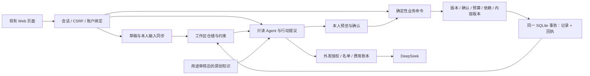

# 业务后端与 Agent 的协作边界

2026-10-29 本地部署候选。生产当前版本另见部署验收记录；此文件不代表已经上线。

## 结构

保留原有 Node HTTP + SQLite 模块化单体。身份、草稿同步、确定性业务命令和模型建议共用账户及工作区，不建立平行的 Agent 用户库或计划库。

`auth-server.mjs` 负责 HTTP、认证与限流；`business-commands.mjs` 组织关键业务动作；`business-store.mjs` 负责账户隔离、规范化、版本、对象持久化和事务；`planning-report.mjs` 组合真实保存资料与目录内容。Agent 只解释或提出提议，不绕过业务规则。

## 13 类命令

统一入口 `POST /api/commands`：`{type, baseVersion, mutationId, payload}`。服务端只读取会话对应的保存状态，客户端不传 owner 或计算结果。

| 命令 | 行为与约束 |
| --- | --- |
| assessment.create | 从已保存且本人确认的材料建立并保存分析快照；保留旧版本，不生成能力总分 |
| task.create | 本人确认预算后创建；检查模板已发布、课程版本、重复任务及预算 |
| task.edit | 按任务与计划版本确认安排；恢复任务重新核对预算，S2 不能编辑成完成 |
| task.start | 检查暂停状态和交付依赖 |
| task.submit | 从当前保存草稿建立不可变成果版本，清除上次标准确认 |
| task.selfcheck | 对具体成果保存本人自检；不声称程序运行或独立核验 |
| task.complete | 检查最新成果、自检、贡献、标准确认和依赖后，记录有限范围完成 |
| evidence.candidates | 从本人选择的实际提交版本建立待确认候选，保留技能、范围与位置；重复条目不增加候选 |
| experience.record | 补录已发生的本人行动；0 小时、明确 recorded 类型、不补造事前预算，材料待确认 |
| claim.confirm | 逐项本人确认或关联重复，增加资料版本，使旧分析失效 |
| claim.withdraw | 撤回且记录撤回版本；重新确认不会恢复已撤回的旧报告引用 |
| report.compose | 先获取服务器预览，确认章节、缺项与原版本后冻结保存；不采用浏览器提交的生成正文 |
| report.compile | 保存按账户事实编译的 Markdown 快照，再由页面下载 |

`POST /api/services/report-preview` 使用保存版本返回草稿正文与摘要；`GET /api/commands/:id` 查询本人回执，`GET /api/commands` 返回最近 100 条本人回执（最多保留 30 天）。现有 `/api/services/assessment`、`report` 只读接口保留兼容。

## 一致性与恢复

同一个命令 ID 与请求摘要只能应用一次。回执和业务记录同事务提交，校验失败不留下部分结果；同 ID 不同请求返回冲突。服务器成果的正文与回执不能由普通工作区保存伪造或改写。人工修订另建版本，普通草稿仍可编辑。

浏览器同步先保存草稿，再发命令。请求结果不明时停止自动保存，重试原命令及原编号；已经收到回执但读取快照失败时，只重新读取快照。期间输入保留，不覆盖同一业务组的并发变更；冲突保留输入并提供下载与重载。连续点击不能替换待恢复命令。

新增一张 `business_command_receipts` 表，外键绑定账户。清空工作区与清理回执、Agent 偏好/反馈同事务完成；删除账户级联删除。SQLite 完整备份自然包含该表，恢复后幂等键仍有效。模型费用账本单独保留，不能恢复旧账本来重新获得额度。

## 自动验收

在项目目录运行 `node scripts/verify-backend.mjs`。若 Python 不在 PATH，设置 `CAREER_TEST_PYTHON` 为解释器路径。入口依次执行全部自动测试、双语检查、服务器构建、真实 Edge 浏览器闭环与合成数据库备份恢复。结果写入 `checks/后端闭环_20261029/acceptance-summary.json`，分项日志和截图在同目录。

验收仅使用本机临时数据库和合成账户，网络请求限制在本机，模型关闭；不能据此声称真实学生建议质量或独立能力核验达标。

## 正式运行的外部条件

- 模型继续按用户要求关闭，8 元原账本不重置。开放试用需明确指定名单及外发同意；已有密钥不需要再次提供。
- 邮箱验证和找回依赖可使用的邮件服务及发件域名授权，目前能力接口明确返回不可用。用户只需提供服务授权或作出服务选择，接入代码和验收仍由工程完成。
- 历史岗位样本不变成实时在招或全国统一门槛。正式招聘数据需要获准来源和适用范围；工程可完成整理、用途检查、版本化和检索。
- 真实学生试用、领域人员复核需要实际参与者。工程可准备问题、记录、评估与修复，不能伪造参与、资质或复核结论。
- 管理界面当前为只读资料概览；现有发布、撤回和备份工具由服务器操作权限控制。管理职责、审核人和公开范围应明确后再开放写入权限，不能把学生账户提升为管理员来填补这一项。

以上是运行能力边界，不能将缺少外部授权的项目写成已经可用，也不要求用户承担工程实现或测试工作。
